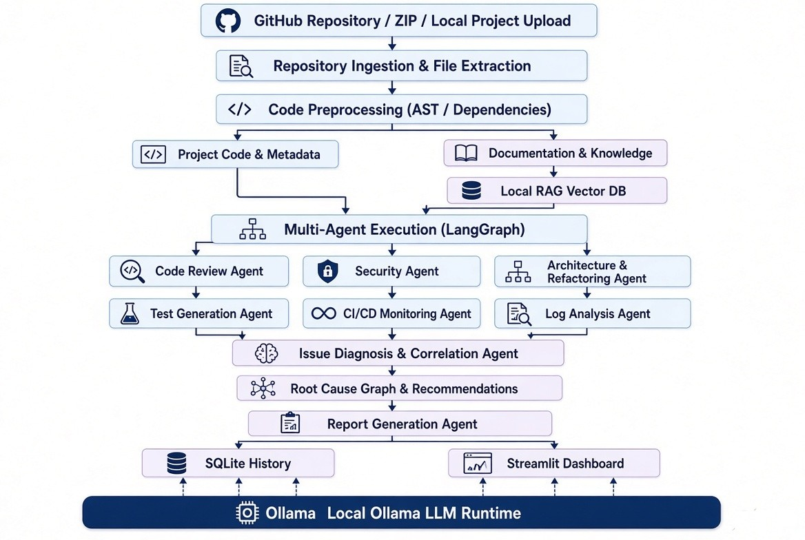
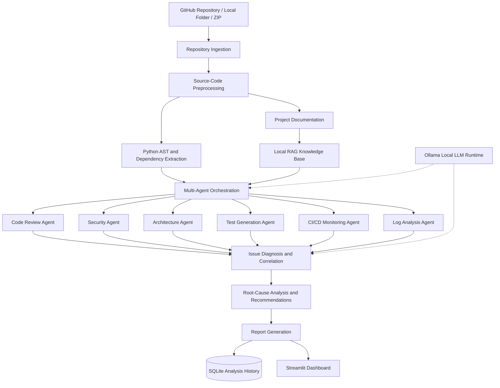
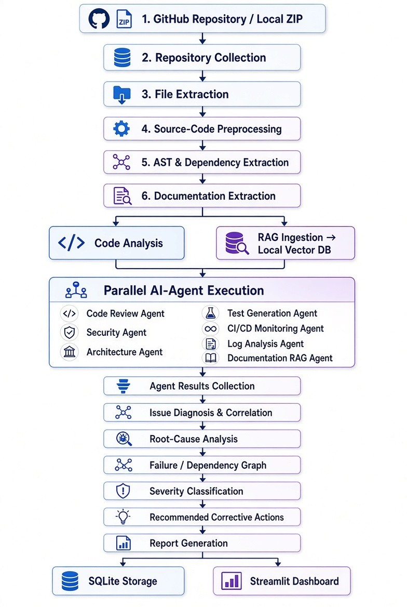
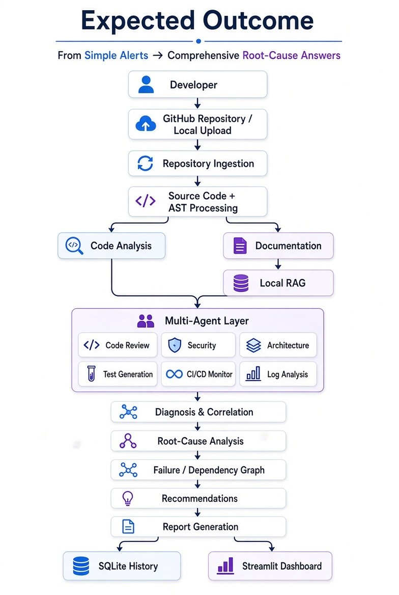

# 🧠 DevOpsMind AI

### Autonomous Software Engineering and CI/CD Intelligence Framework Using AI Agents and Local LLMs

**An AI-powered, privacy-focused DevOps intelligence framework designed to unify source-code analysis, security scanning, architecture evaluation, automated testing, CI/CD monitoring, log analysis, and evidence-based root-cause diagnosis.**


---

## 📌 Table of Contents

1. [Project Overview](#-project-overview)
2. [Problem Statement](#-problem-statement)
3. [Project Objectives](#-project-objectives)
4. [Key Features](#-key-features)
5. [System Architecture](#-system-architecture)
6. [System Workflow](#-system-workflow)
7. [AI Agents](#-ai-agents)
8. [Technology Stack](#-technology-stack)
9. [Project Structure](#-project-structure)
10. [Installation and Setup](#-installation-and-setup)
11. [Running the Application](#-running-the-application)
12. [Example Use Case](#-example-use-case)
13. [Implementation Status](#-implementation-status)
14. [Development Roadmap](#-development-roadmap)
15. [Testing and Evaluation](#-testing-and-evaluation)
16. [Security and Privacy](#-security-and-privacy)
17. [Future Enhancements](#-future-enhancements)
18. [Contributing](#-contributing)
19. [Project Documentation](#-project-documentation)

---

## 🚀 Project Overview

Modern software engineering involves several interconnected activities:

- Source-code development and review
- Security and vulnerability analysis
- Architecture and dependency evaluation
- Automated software testing
- Continuous Integration and Continuous Deployment (CI/CD)
- Build and deployment monitoring
- Log analysis and troubleshooting
- Root-cause investigation
- Technical documentation and reporting

These activities are typically managed using separate tools.

When an application fails, developers often need to manually examine source code, test results, CI/CD pipeline failures, logs, dependency relationships, and documentation to identify the underlying issue.

**DevOpsMind AI aims to bring these activities together into a unified AI-assisted software engineering platform.**

The framework is designed around specialized AI agents that analyze different aspects of a software project and produce structured findings.

A central diagnosis and correlation layer is intended to combine these findings to identify probable root causes, explain failures, and recommend corrective actions.

The system prioritizes local AI inference through Ollama, deterministic analysis tools, modular architecture, and evidence-based recommendations.

### 🎯 Project Vision

> Transform fragmented software engineering and DevOps workflows into an intelligent, connected, and explainable analysis system powered by specialized AI agents and locally executed language models.

**Development note:** DevOpsMind AI is an evolving project. The complete architecture described below represents the target system. Individual capabilities are being implemented and integrated incrementally.

---

## ❗ Problem Statement

Software development teams often face several challenges:

| Challenge | Description |
|---|---|
| Manual Code Review | Reviewing large codebases requires significant developer effort. |
| Security Vulnerabilities | Hardcoded credentials, unsafe coding patterns, and vulnerable dependencies may go unnoticed. |
| Architectural Complexity | Circular dependencies, high coupling, and poor modularity can be difficult to identify. |
| Manual Test Creation | Writing comprehensive tests for functions and edge cases is time-consuming. |
| CI/CD Failures | Failed workflows require manual investigation across multiple stages. |
| Large Log Files | Important error messages can be buried in thousands of log entries. |
| Fragmented Information | Code, tests, logs, security reports, and pipeline results exist in separate systems. |
| Root-Cause Investigation | Determining why a failure occurred often requires correlating multiple sources of evidence. |
| Documentation Discovery | Developers may struggle to locate relevant project-specific information. |
| Reporting Overhead | Consolidating technical findings into actionable reports takes additional effort. |

### Proposed Solution

DevOpsMind AI is designed to integrate:

**Repository Analysis → Specialized AI Agents → Evidence Correlation → Root-Cause Diagnosis → Recommendations → Reporting and Visualization**

Instead of functioning as independent AI chatbots, the agents are intended to operate within a connected software analysis workflow.

---

## 🎯 Project Objectives

The primary objectives of DevOpsMind AI are to:

1. Support GitHub repository, local-folder, and ZIP-based project ingestion.
2. Extract and preprocess source-code files and project metadata.
3. Perform Python AST-based code analysis.
4. Execute local language models using Ollama.
5. Detect code-quality and maintainability issues.
6. Identify potential security vulnerabilities and exposed credentials.
7. Analyze architecture, module dependencies, and circular imports.
8. Generate automated test cases for selected functions.
9. Execute and evaluate generated tests in isolated environments.
10. Monitor GitHub Actions workflow executions.
11. Analyze build, test, deployment, and application logs.
12. Retrieve relevant project documentation using RAG.
13. Correlate findings across specialized agents.
14. Identify probable root causes of software failures.
15. Generate evidence-backed recommendations.
16. Store analysis results and history in SQLite.
17. Produce consolidated technical reports.
18. Present findings through an interactive Streamlit dashboard.

---

## ✨ Key Features

### 🔍 Intelligent Code Review

Designed to identify:

- Syntax errors
- Code smells
- Unused imports and variables
- Complex functions
- Maintainability problems
- Missing error handling
- Potential logical issues
- Refactoring opportunities

The planned analysis combines deterministic tools with local-LLM explanations.

### 🔐 Security and Vulnerability Analysis

Designed to detect:

- Hardcoded API keys and credentials
- Exposed tokens and passwords
- Unsafe coding patterns
- Potential injection vulnerabilities
- Insecure subprocess usage
- Dependency vulnerabilities
- Sensitive information exposure

Security findings should include severity, evidence, affected source locations, and remediation guidance.

### 🏗️ Architecture Intelligence

Analyzes software architecture through:

- Import relationships
- Module dependencies
- Circular dependency detection
- Coupling analysis
- Structural complexity
- Dependency graph generation
- Refactoring recommendations

### 🧪 Automated Test Generation

The target testing workflow includes:

- Function and signature extraction
- Normal-input test scenarios
- Boundary-value testing
- Invalid-input testing
- Exception-handling scenarios
- PyTest code generation
- Test execution and result analysis
- Coverage reporting

Generated code must be executed only in appropriately isolated environments.

### 🔄 CI/CD Monitoring

Planned GitHub Actions integration includes:

- Workflow run monitoring
- Build and test status
- Failed job identification
- Pipeline execution history
- Job log retrieval
- Failure investigation

### 📋 Intelligent Log Analysis

Designed to process:

- Application logs
- Build logs
- Test logs
- Deployment logs
- CI/CD pipeline logs

The Log Analysis Agent extracts relevant errors, warnings, stack traces, and failure events.

### 📚 Documentation Intelligence

The planned RAG subsystem retrieves relevant project knowledge from:

- README files
- Technical documentation
- Configuration guides
- Troubleshooting notes
- Architecture documentation

It uses local embeddings and a vector database to retrieve context for analysis and diagnosis.

### 🧠 Root-Cause Intelligence

The central planned capability of DevOpsMind AI is **evidence-based issue diagnosis and correlation**.

It is designed to combine:

- Code-review findings
- Security findings
- Architecture findings
- Test failures
- CI/CD execution data
- Log errors
- Relevant documentation

The system then identifies possible relationships, ranks probable causes, and recommends corrective actions.

AI-generated diagnoses should clearly distinguish confirmed evidence from hypotheses.

### 📊 Interactive Dashboard

The Streamlit interface is intended to provide a unified workspace for:

- Repository information
- Code-quality findings
- Security findings
- Architecture visualizations
- Test results
- CI/CD status
- Log analysis
- Root-cause investigation
- Reports and analysis history

---

## 🏛️ System Architecture

DevOpsMind AI follows a modular, multi-agent architecture.



### High-Level Architecture



**Architecture note:** This diagram represents the intended complete system, including modules that may not yet be implemented.

---

## ⚙️ System Workflow



The proposed end-to-end workflow consists of six major stages.

### Stage 1 — Repository Ingestion

The system accepts software project information from GitHub repositories, local project directories, or uploaded ZIP archives.

It identifies supported files and collects source code, configuration files, dependencies, and documentation.

### Stage 2 — Source-Code Preprocessing

The preprocessing layer extracts:

- Python functions
- Classes
- Imports
- Dependencies
- Source locations
- Project metadata

Python's Abstract Syntax Tree (AST) provides structured information for downstream analysis.

### Stage 3 — Specialized Agent Execution

Different agents analyze the repository for code quality, security, architecture, testing, pipeline failures, and log errors.

Their outputs are normalized into structured findings.

### Stage 4 — Diagnosis and Correlation

Findings from multiple agents are combined to identify relationships between software defects, failed tests, pipeline events, and log errors.

The diagnosis component evaluates possible causes and supporting evidence.

### Stage 5 — Reporting and Persistence

The system is designed to generate technical reports and persist analysis history using SQLite.

Reports should contain findings, severity levels, source references, explanations, and recommendations.

### Stage 6 — Dashboard Visualization

The Streamlit dashboard provides a central interface for exploring analysis results, visualizations, and historical findings.

---

## 🤖 AI Agents

DevOpsMind AI is designed around the following specialized agents and subsystems.

| Agent | Responsibility | Main Tools / Techniques |
|---|---|---|
| Code Review Agent | Detect code-quality and maintainability issues | Python AST, Ruff, Ollama |
| Security Agent | Identify potential vulnerabilities and exposed secrets | Pattern matching, Bandit, Gitleaks, pip-audit |
| Architecture Agent | Analyze dependencies and structural problems | Python AST, NetworkX |
| Test Generation Agent | Generate and evaluate test scenarios | PyTest, local LLMs |
| CI/CD Monitoring Agent | Monitor GitHub Actions workflows | GitHub Actions API |
| Log Analysis Agent | Extract and interpret software errors | Python, regex, log parsers |
| Documentation RAG Agent | Retrieve relevant project knowledge | Embeddings, FAISS / ChromaDB |
| Issue Diagnosis Agent | Correlate findings and rank probable root causes | Evidence matching, LLM reasoning |
| Reporting Agent | Consolidate findings and recommendations | Markdown, JSON, SQLite |

The agent table describes the target responsibilities and recommended technologies. It does not imply that every integration is currently operational.

---

## 🛠️ Technology Stack

| Category | Technology |
|---|---|
| Programming Language | Python 3.11+ |
| Dashboard | Streamlit |
| Local LLM Runtime | Ollama |
| Local Models | Qwen Coder, Llama, Code Llama |
| Agent Orchestration | LangGraph |
| LLM Integration | LangChain |
| Source-Code Parsing | Python AST |
| Code Quality | Ruff, optionally Pylint |
| Security Analysis | Bandit, Gitleaks, pip-audit |
| Architecture Analysis | NetworkX |
| Automated Testing | PyTest, pytest-cov |
| CI/CD Integration | GitHub Actions API |
| Log Processing | Python logging, regex |
| Embeddings | Hugging Face / Sentence Transformers |
| Vector Database | FAISS or ChromaDB |
| Database | SQLite |
| Visualization | Streamlit, Plotly, Graphviz |
| Data Validation | Pydantic |
| Version Control | Git and GitHub |

Some technologies are planned integrations and may not yet appear in the installed project dependencies.

---

## 📁 Project Structure

The current repository contains the following principal source modules:

```text
devopsmind-ai/
│
├── src/
│   └── devopsmind/
│       │
│       ├── agents/
│       │   ├── architecture_agent.py
│       │   ├── code_review_agent.py
│       │   ├── log_agent.py
│       │   ├── security_agent.py
│       │   └── test_gen_agent.py
│       │
│       ├── database/
│       │   └── sqlite.py
│       │
│       ├── ingestion/
│       │   └── file_parser.py
│       │
│       ├── orchestration/
│       │   └── graph.py
│       │
│       ├── preprocessing/
│       │   └── ast_parser.py
│       │
│       ├── schemas/
│       │   └── findings.py
│       │
│       ├── ui/
│       │   └── app.py
│       │
│       ├── config.py
│       └── main.py
│
├── scripts/
│   └── enable_safe_dashboard_graph.py
│
├── requirements.txt
├── README.md
├── README_WEEK13.md
├── .gitignore
│
├── architecture.jpg
├── Systemworkflow.jpg
├── expected_outcome.jpg
│
├── DevOpsMind_AI_Complete_Proposal.pdf
├── DevOpsMind_AI_Complete_Proposal.docx
└── DevOpsMind_AI_Master_Implementation_Plan.docx
```

Additional development and testing files may exist in the repository.

Local databases, logs, virtual environments, and sensitive configuration files are excluded from version control.

---

## 💻 Installation and Setup

### Prerequisites

Install the following:

- Python 3.11 or later
- Git
- Visual Studio Code or another Python IDE
- Ollama for local LLM functionality

An internet connection is required for initial dependency installation and optional GitHub integrations.

### Step 1 — Clone the Repository

```bash
git clone https://github.com/AkhilSubramaniankr/devopsmind-ai.git
cd devopsmind-ai
```

The repository is currently private, so cloning requires an authorized GitHub account.

### Step 2 — Create a Virtual Environment

**Windows PowerShell**

```powershell
python -m venv .venv
.\.venv\Scripts\Activate.ps1
```

**Linux / macOS**

```bash
python3 -m venv .venv
source .venv/bin/activate
```

### Step 3 — Install Dependencies

```bash
python -m pip install --upgrade pip
pip install -r requirements.txt
```

The exact installed packages depend on the current `requirements.txt`.

### Step 4 — Install Ollama

Download Ollama from:

https://ollama.com

After installation, verify:

```bash
ollama --version
```

Download a supported coding model, for example:

```bash
ollama pull qwen2.5-coder:7b
```

Verify the model is available:

```bash
ollama list
```

The selected model must match the application's configured Ollama model.

### Step 5 — Configure the Application

Review:

```text
src/devopsmind/config.py
```

Configure any required local paths, Ollama settings, and database options according to the current application configuration.

Do not commit API tokens, passwords, or private credentials.

---

## ▶️ Running the Application

From the project root, with the virtual environment activated:

```bash
streamlit run src/devopsmind/ui/app.py
```

Streamlit normally opens the dashboard at:

```text
http://localhost:8501
```

If it does not open automatically, copy the local URL shown in your terminal into your browser.

**Note:** The dashboard's available pages and agent functionality depend on the current implementation. The complete proposed feature set may not yet be accessible.

---

## 💡 Example Use Case

### Scenario: Investigating a Failed Software Build

Consider a Python application where a recent dependency update introduces an incompatible API.

As a result:

- A function raises an import error.
- An automated test fails.
- A GitHub Actions workflow reports a failed job.
- The build logs contain the relevant traceback.

### Traditional Approach

A developer manually examines the failed workflow, reads the logs, identifies the source file, checks dependencies, reproduces the error, and determines a correction.

### DevOpsMind AI — Target Workflow

**1. Repository Analysis**

The system collects source code, dependencies, and project metadata.

**2. Code Review**

The Code Review Agent identifies relevant source-code issues.

**3. Test Analysis**

The testing subsystem detects failed test cases and captures error details.

**4. CI/CD Monitoring**

The CI/CD Agent retrieves the failed GitHub Actions workflow and job information.

**5. Log Analysis**

The Log Analysis Agent extracts the import error and relevant traceback.

**6. Evidence Correlation**

The diagnosis component links the failed test, error message, dependency information, and affected source file.

**7. Root-Cause Recommendation**

The system identifies a probable dependency compatibility issue and recommends reviewing the changed dependency version and affected imports.

**8. Report Generation**

The final report presents the evidence, probable cause, confidence or uncertainty, and recommended corrective action.

This is a representative target scenario, not a claim of a completed end-to-end demonstration.

---

## 🚧 Implementation Status

DevOpsMind AI is currently under active development.

The GitHub repository includes source modules for several core components. Their presence confirms that implementation work exists, but does not independently verify end-to-end functionality.

| Component | Repository Status |
|---|---|
| Git repository and version control | Initialized and pushed to GitHub |
| Project configuration | Source module present |
| Repository ingestion | Source module present |
| Python AST preprocessing | Source module present |
| Code Review Agent | Source module present |
| Security Agent | Source module present |
| Architecture Agent | Source module present |
| Test Generation Agent | Source module present |
| Log Analysis Agent | Source module present |
| SQLite persistence | Source module present |
| Agent orchestration | Source module present |
| Streamlit dashboard | Source module present |
| GitHub Actions monitoring | Planned / verification pending |
| Documentation RAG | Planned |
| Multi-agent root-cause diagnosis | Planned / integration pending |
| Complete end-to-end evaluation | Pending |

This status table should be updated as features are tested and verified.

---

## 🗓️ Development Roadmap

The project follows a structured 15-week implementation guide.

| Week | Development Focus |
|---|---|
| 1 | Project setup, configuration, Ollama, SQLite, and application skeleton |
| 2 | Repository ingestion and AST preprocessing |
| 3 | Code Review Agent |
| 4 | Security and Vulnerability Agent |
| 5 | Architecture and Refactoring Agent |
| 6 | Automated Test Generation |
| 7 | Test Execution and Coverage |
| 8 | GitHub Actions CI/CD Monitoring |
| 9 | Log Analysis Agent |
| 10 | Documentation RAG |
| 11 | LangGraph Multi-Agent Orchestration |
| 12 | Issue Diagnosis and Root-Cause Correlation |
| 13 | Reporting and SQLite Analysis History |
| 14 | Complete Streamlit Dashboard Integration |
| 15 | Testing, Evaluation, Documentation, and Final Demonstration |

The roadmap describes the planned development sequence rather than verified completion dates.

### Development Priorities

**Core baseline**

Repository ingestion, Python AST processing, code review, security scanning, test generation, log analysis, SQLite storage, basic diagnosis, and a working dashboard.

**Advanced integration**

LangGraph orchestration, local RAG, GitHub Actions monitoring, architecture visualizations, and evidence-linked recommendations.

**Future expansion**

Multi-language analysis, automated repair workflows, advanced causal graphs, and broader monitoring capabilities.

---

## 🧪 Testing and Evaluation

The project aims to evaluate its components using reproducible test cases and known software defects.

### Code Review Evaluation

- Issue detection accuracy
- False-positive rate
- Quality of explanations
- Usefulness of recommendations

### Security Evaluation

- Secret detection accuracy
- Vulnerability identification
- Precision and recall
- False-positive and false-negative analysis

### Architecture Evaluation

- Circular dependency detection accuracy
- Dependency graph correctness
- Refactoring recommendation quality

### Automated Testing Evaluation

- Generated test validity
- Test execution success rate
- Code coverage
- Boundary and edge-case coverage

### CI/CD and Log Analysis Evaluation

- Failed workflow identification
- Error extraction accuracy
- Relevant log-event detection
- Failure explanation quality

### Root-Cause Evaluation

- Probable cause identification accuracy
- Evidence traceability
- Recommendation correctness
- Confidence and uncertainty reporting

### Local LLM Evaluation

- Response latency
- Token generation speed
- Memory consumption
- Quality and reliability of generated explanations

Evaluation results will be documented as the relevant components are implemented and tested.

---

## 🔒 Security and Privacy

DevOpsMind AI prioritizes local execution and secure handling of software project information.

### Local AI Processing

The planned system uses Ollama to run supported language models locally, reducing the need to transmit source code to third-party LLM services.

### Sensitive Information

The repository excludes local development artifacts such as:

```gitignore
.venv/
.env
.env.*
!.env.example
__pycache__/
*.db
*.sqlite
*.sqlite3
logs/
*.log
```

Additional exclusions are maintained in `.gitignore`.

### Security Considerations

- Never commit real API keys, access tokens, passwords, or private credentials.
- Review all files before pushing changes to GitHub.
- Use dedicated security scanners where appropriate.
- Treat LLM-generated security findings as suggestions requiring verification.
- Redact sensitive values from logs and reports.
- Use minimum necessary permissions for GitHub integrations.
- Execute generated tests in isolated environments with appropriate restrictions.
- Review uploaded repositories and archives before processing them.

### Privacy Limitations

Local LLM inference does not mean every operation is offline.

GitHub repository access and GitHub Actions monitoring require communication with GitHub when those integrations are used.

Uploaded project content, logs, and generated reports should be handled according to their sensitivity.

**Security disclaimer:** DevOpsMind AI is a development-stage analysis framework and should not be treated as a replacement for professional security review.

---

## 🔮 Future Enhancements

Planned future improvements include:

- Multi-language source-code analysis
- Automated patch recommendations
- Controlled code-repair workflows
- Advanced dependency and causal graphs
- Real-time CI/CD monitoring
- Historical analysis comparisons
- Additional security scanners
- Performance analysis agents
- License compliance analysis
- Cost optimization agents
- Enhanced RAG-based troubleshooting
- More comprehensive automated regression testing
- Scalable repository analysis

---

## 🤝 Contributing

DevOpsMind AI is currently maintained as a private development project.

A public contribution process may be introduced in the future.

For authorized contributors:

1. Create a development branch.
2. Implement changes with appropriate tests.
3. Run relevant code-quality and security checks.
4. Document any new features or configuration changes.
5. Submit changes for review before merging.

---

## 📚 Project Documentation

The repository includes supporting project documentation:

**Complete Project Proposal**

[DevOpsMind AI — Complete Proposal (PDF)](DevOpsMind_AI_Complete_Proposal.pdf)

Describes the project motivation, objectives, architecture, proposed agents, workflow, functional requirements, and evaluation strategy.

**Master Implementation Plan**

`DevOpsMind_AI_Master_Implementation_Plan.docx`

Provides the structured 15-week implementation roadmap, technical specifications, recommended tools, development milestones, and final evaluation criteria.

**Week 13 Documentation**

[Week 13 README](README_WEEK13.md)

Contains development-stage documentation associated with reporting and persistence work.

### Project Visualizations



*Illustrative expected outcome of the DevOpsMind AI project.*

---

## ⭐ Project Goal

DevOpsMind AI is being developed to demonstrate how **AI agents, deterministic software-analysis tools, local language models, and DevOps automation** can work together to support software engineering tasks.

Its long-term goal is to provide developers with a unified platform that does more than identify isolated problems: it connects technical evidence, explains probable causes, and supports informed corrective decisions.

---

**DevOpsMind AI — From Software Analysis to Intelligent Root-Cause Diagnosis.**

*Built with Python, Streamlit, Ollama, and an evolving multi-agent architecture.*
